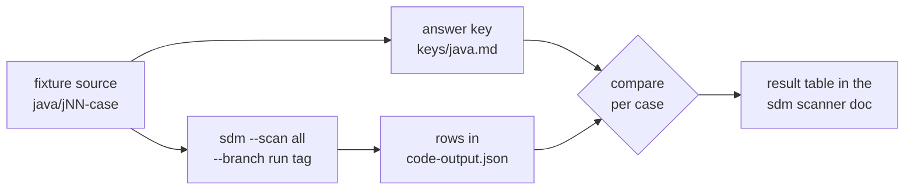

# sdm-scan-fixtures

Test cases for the code scanner in `sdm`. Each case is a small piece of Java that uses
one crypto API in one way, so we can check what the scanner reports for it.

**These files contain deliberately weak crypto (ECB mode, MD5, SHA-1).** They exist to be
scanned. They are not examples to copy.

## Table of Contents

- [How it works](#how-it-works)
- [Cases](#cases)
- [Layout](#layout)
- [Running a case](#running-a-case)
- [License](#license)

## How it works

The answer key for each case is written from the source, in its own commit, before any
scanner output exists for the repo. A run is pinned by a tag on the key commit.



## Cases

Every file starts with a comment `// case: jNN`, so a row's file path maps to its case.

| ID | Folder | What it tests | Written by |
|----|--------|---------------|------------|
| j01 | `j01-aes-ecb-control` | A direct `Cipher.getInstance("AES/ECB/PKCS5Padding")` call (control) | fixture author |
| j02 | `j02-md5-control` | A direct `MessageDigest.getInstance("MD5")` call (control) | fixture author |
| j03 | `j03-keygen-size` | `KeyGenerator.getInstance("AES")` then `init(256)` (key size) | maintainer, pending |
| j04 | `j04-constant-same-class` | The algorithm is a constant in the same class | fixture author |
| j05 | `j05-constant-in-other-class` | The algorithm is a constant in another class | fixture author |
| j06 | `j06-env-var` | The algorithm comes from an environment variable | maintainer, pending |
| j07 | `j07-repeat-calls` | The same call twice in one file and once in a second file | fixture author |
| j08 | `j08-wrapper` | A wrapper method called with `"AES"` | maintainer, pending |
| j09 | `j09-test-dir-only` | Crypto only under `src/test/` | fixture author |
| j10 | `j10-vendor-only` | Crypto only under `vendor/` | fixture author |

## Layout

```text
java/<case-id>/src/main/java/fixtures/   one folder per case
java/j09-test-dir-only/src/test/...      the test-directory case
java/j10-vendor-only/vendor/lib/...      the vendored-directory case
keys/java.md                             the answer key (added in its own commit)
```

## Running a case

After the key commit, tag it `run-<date>-<n>` and scan that tag:

```text
sdm --scan all --repo-url https://github.com/PQ-Station/sdm-scan-fixtures --branch run-<date>-<n>
```

## License

Not set yet. The maintainer chooses it.
